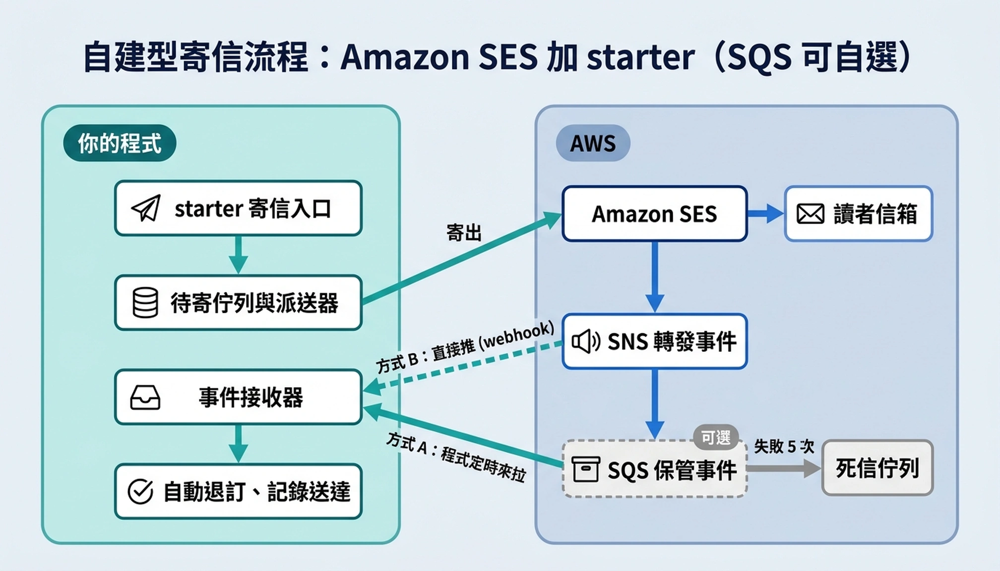

# ses-mail-spring-boot-starter

用 Amazon SES 寄信的 Spring Boot starter：同步寄交易信、把群發與排程信放進資料庫佇列依速率送出、可取消排程、查詢 SES 額度。

Amazon SES starter for Spring Boot: synchronous transactional mail, a database-backed queue for bulk and scheduled mail (rate-limited dispatch, cancellable schedules), and quota lookup.

- Java 21、Spring Boot 3.5、AWS SDK v2
- 佇列存在應用程式的 PostgreSQL（`scheduled_mail` 表），以 JdbcClient 存取，不需要 JPA
- 派送器自帶單執行緒排程器，不需要 `@EnableScheduling`
- 退信／檢舉／送達事件可選 SQS 拉取或 HTTPS webhook



和託管型寄信服務（ZSend、Resend）的對照、排程與事件接收的取捨、方案費用，見 [架構說明](docs/architecture.md)。

## 安裝（JitPack）

```xml
<repositories>
  <repository>
    <id>jitpack.io</id>
    <url>https://jitpack.io</url>
  </repository>
</repositories>

<dependency>
  <groupId>com.github.kevintsai1202</groupId>
  <artifactId>ses-mail-spring-boot-starter</artifactId>
  <version>0.3.0</version>
</dependency>
```

## 建立資料表

把 [`ses-mail-postgresql.sql`](src/main/resources/io/github/kevintsai1202/sesmail/schema/ses-mail-postgresql.sql) 複製成自己專案的下一個 Flyway migration。沒用 Flyway 的話，設 `sesmail.queue.initialize-schema=true`，啟動時會以 `IF NOT EXISTS` 建表。

## 設定

```yaml
sesmail:
  enabled: true                       # 預設 false
  region: ap-northeast-1
  access-key-id: ${AWS_SES_ACCESS_KEY_ID:}       # 兩把都空白時改用 SDK 預設憑證鏈
  secret-access-key: ${AWS_SES_SECRET_ACCESS_KEY:}
  from: "凱文大叔 <noreply@example.com>"          # 中文名稱自動做 RFC 2047 編碼
  reply-to: ""
  configuration-set: ""                # 選填
  max-send-rate: 5                     # 不要高於 SES 帳號的 Maximum send rate（沙箱為 1）
  dispatch-interval: 10s
```

IAM 權限只需要 `ses:SendEmail` 與 `ses:GetAccount`。

## 使用

```java
@Service
class NewsletterService {
    private final SesMailClient mail;

    NewsletterService(SesMailClient mail) { this.mail = mail; }

    void demo() {
        // 交易信：同步寄出，回傳 SES MessageId
        mail.send("reader@example.com", "登入連結", "<p>...</p>");

        // 群發：整批寫入佇列（全有或全無），回傳 ses-batch-*，約一個派送間隔內送出
        String batchRef = mail.enqueueBatch(List.of(new OutgoingMail("a@example.com", "第 1 期", "<p>...</p>")));

        // 排程與取消：只有還沒被派送器認領的信取消得了
        String ref = mail.schedule(new OutgoingMail("b@example.com", "第 2 期", "<p>...</p>"),
                Instant.parse("2026-11-01T01:00:00Z"));
        boolean cancelled = mail.cancel(ref);
    }
}
```

派送結果：宣告 `DeliveryListener` bean。

```java
@Component
class EmailLogUpdater implements DeliveryListener {
    @Override
    public void onFailed(String ref, String recipient, String error) {
        // 依 ref（ses-batch-* 或 ses-sched-*）與收件人更新自己的寄送記錄
    }
}
```

額度：`SesQuotaService.snapshot()` 回傳狀態（`sandbox`／`paused`／`healthy`…）、24 小時上限、已寄、佇列待寄與 `remaining()`。每次呼叫都會打 SES API，請自行快取。

## 退信／檢舉／送達事件

SES 透過 configuration set 把事件發到 SNS topic。應用程式有兩種接收方式，共用同一套驗簽（AWS SDK 官方 `SnsMessageManager`）、topic 白名單與分派：

| | SQS 拉取（建議，0.3.0 起） | HTTPS webhook（0.2.0 起） |
| --- | --- | --- |
| 流程 | SNS → SQS → 應用程式長輪詢 | SNS → `POST /sesmail/sns` |
| 應用程式停機時 | 事件留在佇列，回來再處理 | SNS 短暫重試後遺失 |
| 處理失敗 | 不刪除，SQS 重送，超過次數進死信佇列 | 回 200，不重試 |
| 對外端點 | 不需要 | 需公網可達、不能被登入或 Host 白名單擋 |

```yaml
sesmail:
  configuration-set: newsletter     # 事件由這個 configuration set 發佈
  sns:
    topic-arns: arn:aws:sns:ap-northeast-1:123456789012:ses-events   # 兩種模式都必填
  sqs:
    enabled: true
    queue-url: https://sqs.ap-northeast-1.amazonaws.com/123456789012/ses-events
```

宣告 `SesEventListener` bean 處理事件；SNS／SQS 可能重送，實作要冪等。每個事件都有 `ref()`：佇列寄出的信是 `enqueueBatch`／`schedule` 回傳的參照（starter 用 MessageId 反查佇列表），交易信則是 `send` 回傳的 MessageId，可直接對回自己的寄送記錄。

```java
@Component
class MailEvents implements SesEventListener {
    @Override public void onBounce(SesBounce bounce) {
        if (bounce.permanent()) bounce.recipients().forEach(this::unsubscribe);
    }
    @Override public void onComplaint(SesComplaint complaint) {
        complaint.recipients().forEach(this::unsubscribe);
    }
    @Override public void onDelivery(SesDelivery delivery) {
        delivery.recipients().forEach(r -> markDelivered(delivery.ref(), r));
    }
}
```

listener 拋例外時：SQS 模式保留訊息重試；webhook 模式只記 log。

AWS 端（SQS 模式）：SNS topic → SQS 佇列＋死信佇列（佇列政策允許該 topic 發送）→ 佇列訂閱 topic（不要開 raw message delivery）→ SES configuration set 加事件目的地（Bounce、Complaint、Delivery）指向 topic → IAM 加 `sqs:ReceiveMessage`、`sqs:DeleteMessage`、`sqs:ChangeMessageVisibility`。用了 configuration set 就**不要**再設身分層級的回饋通知，否則同一封退信會收到兩次。

升級注意（0.3.0）：`SesBounce`／`SesComplaint` 多了第一個欄位 `ref`；schema 多了 `provider_message_id` 索引（用 Flyway 的專案請自行加進 migration）。

## 派送規則

- 節流、網路錯誤、SES 5xx：退回佇列，30 秒、60 秒、120 秒…退避，最多 5 次
- 其他錯誤（位址被拒、網域未驗證、帳號停權）：直接失敗，通知 `onFailed`
- 程序中斷後卡在 `SENDING` 的信**不會自動重寄**（無法得知 SES 是否已收到），每 30 分鐘記一次警告，請人工處理：

```powershell
# 查看卡住的信
psql $env:DATABASE_URL -c "SELECT id, recipient, subject, updated_at FROM scheduled_mail WHERE status = 'SENDING' AND updated_at < now() - interval '10 minutes';"
# 確定沒收到、要補寄
psql $env:DATABASE_URL -c "UPDATE scheduled_mail SET status = 'PENDING', next_attempt_at = now(), updated_at = now() WHERE id = <id>;"
```

## 開發

```powershell
# 測試需要本機 PostgreSQL（預設 127.0.0.1:5433，postgres/password，可用 SESMAIL_TEST_DB_* 覆寫）
$env:JAVA_HOME = 'D:\java\jdk-21'
mvn -B test
```

## 授權

MIT License，見 [LICENSE](LICENSE)。
