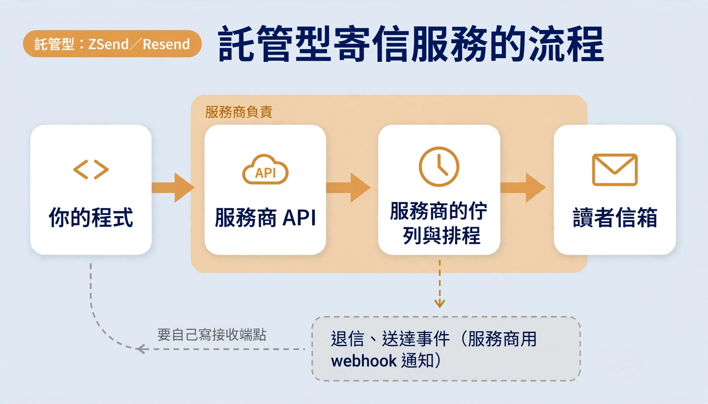

# 架構說明：為什麼用 Amazon SES 自建寄信

託管型寄信服務（例如 ZSend、Resend）把佇列、排程、重試和事件都放在服務商那端，程式最少，但受方案額度限制，也看不到內部。這個 starter 把這些搬回你的 Spring Boot 程式，Amazon SES 只負責把信送出去：費用低、行為可測可查，代價是要自己顧一些 AWS 設定。

事件要不要經過 SQS 也由你決定：要可靠就加 SQS 讓程式來拉，想簡單就讓 SNS 直接推給 starter 內建的接收器。

## 兩種做法的流程

託管型：呼叫服務商 API，之後都是服務商的事；退信、送達事件用 webhook 通知，接收端點要自己寫。



自建型（本 starter）：寄信入口、待寄佇列與派送器都在你的程式裡；SES 的事件交給 SNS，再由你選擇 SQS 拉取或 webhook 直接推。


## 同一個功能，各由誰做

| 功能 | 託管型（ZSend、Resend） | 自建型（Amazon SES ＋ 本 starter） |
| --- | --- | --- |
| 接收寄信 | 服務商 API | `SesMailClient` |
| 排程與重試 | 服務商的排程器：帶上寄送時間，時間到由它寄 | 待寄佇列（`scheduled_mail`）＋派送器每 10 秒掃一次；程式要在線 |
| 投遞 | 服務商 | Amazon SES |
| 退信、送達通知 | webhook：服務商把事件 POST 到你寫的接收端點 | SES configuration set → SNS topic |
| 事件暫存 | 沒有佇列，只靠服務商重送 | SQS（可選）：事件存在佇列，程式來拉，失敗重送，5 次後進死信佇列 |
| 處理事件 | 自己寫 | 你寫 `SesEventListener`；驗簽、topic 白名單、對回寄送參照由 starter 處理 |

## 事件接收：SQS 要不要，自己選

兩種方式共用同一套驗簽（AWS SDK `SnsMessageManager`）、topic 白名單與事件分派，`SesEventListener` 只寫一次。用設定開關切換，**只開一個**，兩個都開會收到重複事件。

| | 方式 A：SQS 拉取 | 方式 B：HTTPS webhook |
| --- | --- | --- |
| 開關 | `sesmail.sqs.enabled=true`＋`sesmail.sqs.queue-url` | `sesmail.sns.enabled=true`（路徑預設 `/sesmail/sns`） |
| 流程 | SNS → SQS → `SqsEventPoller` 長輪詢（每次最多等 20 秒，有事件立刻回） | SNS → `POST /sesmail/sns`（`SnsWebhookController`） |
| 要建的 AWS 資源 | SNS topic、SQS 佇列、死信佇列、IAM 讀佇列權限 | SNS topic、HTTPS 訂閱 |
| 對外端點 | 不用 | 要，公開 HTTPS 網址 |
| 服務停機時 | 事件留在佇列（預設保存 4 天），回來再處理 | SNS 重試約 1 分鐘後丟棄 |
| 處理失敗時 | 不刪訊息，SQS 重送，5 次後進死信佇列 | 只記 log |
| 適合 | 正式電子報，退訂不能漏 | 寄量小、先求簡單，之後再加 SQS |

```yaml
sesmail:
  sns:
    topic-arns: arn:aws:sns:ap-northeast-1:123456789012:ses-events  # 兩種方式都必填
    enabled: false        # 方式 B
  sqs:
    enabled: true         # 方式 A
    queue-url: https://sqs.ap-northeast-1.amazonaws.com/123456789012/ses-events
```

**SQS 能不能主動推？** 不能，SQS 只能被拉。長輪詢有事件就立刻回應，實際延遲通常只有幾秒。真的要推，得在 SQS 後面再接 Lambda 或 EventBridge Pipes 代為拉取，多一個服務要管。

## 排程：時間到了誰來寄

託管服務有自己的排程器：呼叫排程 API 時帶上寄送時間，時間到由服務商寄出，那時你的程式停機也沒關係。

SES 只會「現在寄」，排程由 starter 的派送器（`ScheduledMailDispatcher`）負責：

- 排程信先寫進 `scheduled_mail`，附上寄送時間。
- 派送器每 10 秒（`sesmail.dispatch-interval`）掃一次到期的信，一輪最多 200 封，逐封認領後依 `sesmail.max-send-rate`（預設每秒 5 封）交給 SES。
- **程式要在線**：停機或重新部署期間不會寄；恢復後補寄已過時間的信，晚到但不遺失。
- **取消不會跟派送打架**：認領和取消都是條件式更新，已被認領的信取消不了，已取消的信不會被寄出。
- **重試與卡住**：暫時性錯誤從 30 秒起倍增退避，最多 5 次。程式在送信途中當掉時，已認領的信會停在處理中；超過 10 分鐘會記警告，交由人工確認，不自動重寄，以免收件人收到兩封。

## 元件對照

| 元件 | 類別或資源 | 作用 |
| --- | --- | --- |
| 寄信入口 | `SesMailClient` | `send` 同步寄交易信；`enqueueBatch`、`schedule` 放進佇列；`cancel` 取消排程 |
| 待寄佇列 | `scheduled_mail`（`ScheduledMailQueue`） | 存在你的 PostgreSQL，以 JdbcClient 存取 |
| 派送器 | `ScheduledMailDispatcher` | 掃描、認領、限速、退避重試；結果通知 `DeliveryListener`（`onSent`、`onFailed`） |
| 事件來源 | SES configuration set → SNS topic | Bounce、Complaint、Delivery 三種事件 |
| 事件接收（方式 A） | SQS 佇列＋死信佇列 → `SqsEventPoller` | 長輪詢拉取，處理成功才刪除 |
| 事件接收（方式 B） | SNS HTTPS 訂閱 → `SnsWebhookController` | 自動確認訂閱 |
| 事件處理 | `SesEventListener`（你實作） | `onBounce`、`onComplaint`、`onDelivery`；事件的 `ref()` 對回寄送參照 |
| 額度 | `SesQuotaService` | 呼叫 SES GetAccount 取得 24 小時上限與已寄數 |

## 誰負責什麼

| 工作 | ZSend | Resend | SES ＋ 本 starter |
| --- | --- | --- | --- |
| 批次群發 | 服務商 | 服務商 | 自建佇列，單一 INSERT，全有或全無 |
| 排程、取消 | 服務商 | 服務商 | 自建派送器，程式停機就不寄；派送與取消不會互相蓋掉 |
| 速率控制、重試 | 服務商 | 服務商 | 自建派送器，30 秒起倍增退避，最多 5 次 |
| 額度查詢 | Zeabur GraphQL | 無專用 API | SES GetAccount |
| 退信、檢舉 | webhook，重試 3 次（約 7 秒內） | webhook，重試 7 次（約 1 天內） | SNS → SQS 或 webhook，自選 |
| 送達狀態 | webhook | webhook | `onDelivery` 事件 |
| 停寄名單 | 不明 | 服務商 | SES 帳號層級 suppression list |
| 信譽監控 | 不明 | 儀表板 | CloudWatch 警報（自己設） |

## 方案與費用（2026-10 查證）

| | ZSend（Zeabur Email） | Resend | Amazon SES |
| --- | --- | --- | --- |
| 入門 | 綁 Zeabur 訂閱，Free 方案不能用；Dev 方案 $5／月：每天 100 封、每月 3,000 封 | 免費：每天 100 封、每月 3,000 封 | 沙箱：每天 200 封、每秒 1 封，只能寄給已驗證信箱 |
| 升級 | Pro 方案 $19／月：每月 5 萬封、不限每日；超額每千封 $0.90 | Pro $20／月：每月 5 萬封 | 每千封 $0.10；申請生產存取權通過後通常是每天 5 萬封（依用途審核），可再申請調高 |

額度與價格會變動，以各家官方頁面為準：

- [Zeabur Email 配額與超額計費](https://zeabur.com/docs/zh-TW/email/quotas-and-overage)、[Zeabur Pricing](https://zeabur.com/pricing)、[Zeabur Email Webhook](https://zeabur.com/docs/zh-TW/email/webhooks)
- [Resend webhook 重試與重播](https://resend.com/docs/webhooks/retries-and-replays)
- [Amazon SES 服務配額](https://docs.aws.amazon.com/ses/latest/dg/quotas.html)、[申請生產存取權](https://docs.aws.amazon.com/ses/latest/dg/request-production-access.html)
